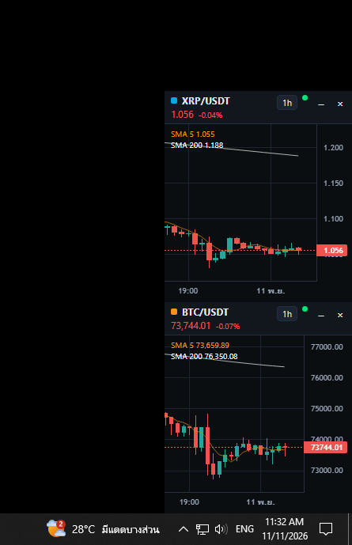

# Crypto Chart Monitor

มอนิเตอร์กราฟ XRPUSDT และ BTCUSDT บน Windows หน้าต่างเล็กสองบานชิดขอบขวาของจอ เลื่อนขึ้นลงพร้อมกัน



## เปิดแอป

ดับเบิลคลิก `start.bat` หรือรัน

```bat
npm install
npm start
```

ต้องมี [Node.js](https://nodejs.org)

## สร้างไฟล์ .exe

ดับเบิลคลิก `build.bat` หรือรัน

```bat
npm install
npm run build
```

ไฟล์ที่ได้คือ `dist\CryptoChartMonitor.exe` เปิดได้เลยโดยไม่ต้องติดตั้ง ไอคอนของโปรแกรมมาจาก `icon.png` Windows อาจเตือน SmartScreen ในครั้งแรกเพราะไฟล์ไม่ได้เซ็นชื่อดิจิทัล ให้เลือก More info แล้วกด Run anyway

## สิ่งที่แสดง

- ราคาล่าสุด และเปอร์เซ็นต์เปลี่ยนจากราคาเปิดของแท่งรายวันบน Binance สีเขียวเมื่อขึ้น สีแดงเมื่อลง
- แท่งเทียนสีของ TradingView พร้อม SMA 5 สีส้ม และ SMA 200 สีขาว
- โหลดย้อนหลัง 500 แท่งตอนเปิด และเปิดมาที่ 20 แท่งล่าสุด เลื่อนกราฟไปทางซ้ายเพื่อดึงราคาก่อนหน้านั้นเพิ่มครั้งละ 1,000 แท่ง
- ข้อมูลจาก Binance ทั้งประวัติและราคาแบบเรียลไทม์

## การใช้

คลิกขวาที่กราฟเพื่อเปิดเมนู

- เปลี่ยนไทม์เฟรม และขนาดกราฟ
- รีเซ็ตมุมมองกลับไปที่ 20 แท่งล่าสุด
- แยกเป็นหน้าต่างอิสระ หรือชิดขอบขวาอีกครั้ง
- เปิดหรือซ่อนหน้าต่าง XRP และ BTC
- ตรึงให้อยู่บนสุดเสมอ

ลากแถบด้านบนของหน้าต่างที่ชิดขอบเพื่อเลื่อนทั้งคู่พร้อมกัน กด Shift แล้วลากบนกราฟเพื่อวัดระยะเป็นเปอร์เซ็นต์ ปุ่มปิดจะซ่อนหน้าต่างไว้ ดับเบิลคลิกไอคอนที่ถาดระบบเพื่อเปิดทั้งสองบานกลับมา
