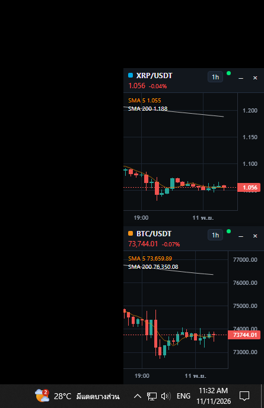

# Crypto Chart Monitor

มอนิเตอร์กราฟบน Windows หน้าต่างเล็กชิดขอบขวาของจอ เลื่อนขึ้นลงพร้อมกัน และขยายกว้างกับสูงแยกกันได้

เริ่มต้นด้วย XRPUSDT และ BTCUSDT คลิกขวาแล้วเลือก **เพิ่มรายการเฝ้าดู** เพื่อเพิ่มคริปโตจาก Binance หุ้นเช่น AAPL หรือทอง (GC=F, GLD, PAXG)



## เปิดแอป

ดับเบิลคลิก `start.bat` หรือรัน

```bat
npm install
npm start
```

ต้องมี [Node.js](https://nodejs.org)

## สร้างไฟล์ .exe

ดับเบิลคลิก `build.bat` หรือรัน

```bat
npm install
npm run build
```

ไฟล์ที่ได้คือ `dist\CryptoChartMonitor.exe` เปิดได้เลยโดยไม่ต้องติดตั้ง ไอคอนของโปรแกรมมาจาก `icon.png` Windows อาจเตือน SmartScreen ในครั้งแรกเพราะไฟล์ไม่ได้เซ็นชื่อดิจิทัล ให้เลือก More info แล้วกด Run anyway

## วิดเจ็ต Android

โปรเจกต์อยู่ใน `app_androind` วิดเจ็ตหน้าโฮมแสดงกราฟ XRP หรือ BTC จาก Binance พร้อม SMA 5 สีส้ม SMA 200 สีขาว และเปอร์เซ็นต์ของวัน

ดับเบิลคลิก `app_androind\build.bat` ไฟล์ติดตั้งคือ `app_androind\app\build\outputs\apk\release\app-release.apk` ชุดนี้เซ็นชื่อเฉพาะเครื่องที่ใช้บิลด์ ปิดทราฟฟิกที่ไม่เข้ารหัส และไม่เปิดโหมดดีบัก

บนมือถือ กดค้างที่หน้าโฮม เลือกวิดเจ็ต **กราฟคริปโต** แล้วเลือกเหรียญกับไทม์เฟรม เพิ่มได้ทั้งสองเหรียญ แตะวิดเจ็ตเพื่ออัปเดตราคา และระบบจะดึงราคาใหม่อีกครั้งประมาณทุก 15 นาที

## สิ่งที่แสดง

- ราคาล่าสุด และเปอร์เซ็นต์เปลี่ยนจากราคาเปิดของวัน สีเขียวเมื่อขึ้น สีแดงเมื่อลง
- แท่งเทียนสีของ TradingView พร้อม SMA 5 สีส้ม และ SMA 200 สีขาว
- โหลดย้อนหลังตอนเปิดที่ 20 แท่งล่าสุด เลื่อนกราฟไปทางซ้ายเพื่อดึงราคาก่อนหน้านั้นเพิ่ม
- คริปโตและ PAXG มาจาก Binance หุ้นกับทองมาจาก Yahoo Finance

## การใช้

คลิกขวาที่กราฟเพื่อเปิดเมนู

- เปลี่ยนไทม์เฟรม และขนาดกราฟทั้งความกว้างและความสูง
- รีเซ็ตมุมมองกลับไปที่ 20 แท่งล่าสุด
- แยกเป็นหน้าต่างอิสระ หรือชิดขอบขวาอีกครั้ง
- เพิ่มรายการเฝ้าดู: คริปโต หุ้น หรือทอง แล้วเปิดหรือซ่อนแต่ละหน้าต่าง
- ตรึงให้อยู่บนสุดเสมอ

ลากขอบหน้าต่างเพื่อย่อหรือขยายเฉพาะบานนั้น ทั้งแนวตั้งและแนวนอน หน้าต่างที่ชิดขอบขวายังเรียงติดกันและเลื่อนขึ้นลงพร้อมกัน กด Shift แล้วลากบนกราฟเพื่อวัดระยะเป็นเปอร์เซ็นต์ ปุ่มปิดจะซ่อนหน้าต่างไว้ ดับเบิลคลิกไอคอนที่ถาดระบบเพื่อเปิดทุกรายการกลับมา
